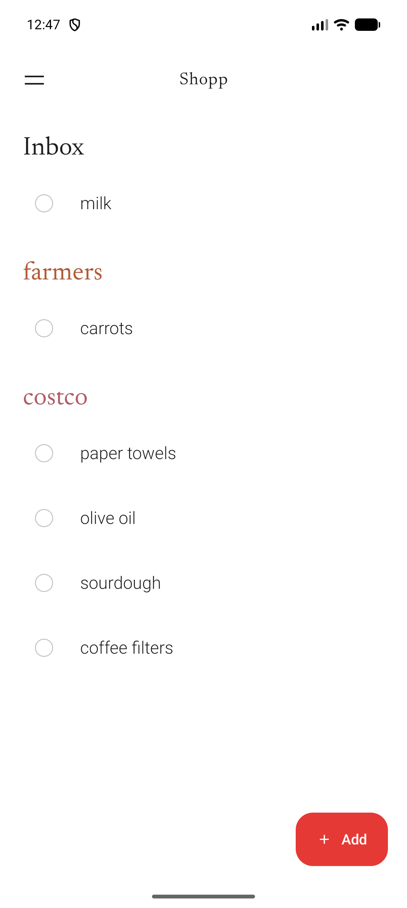
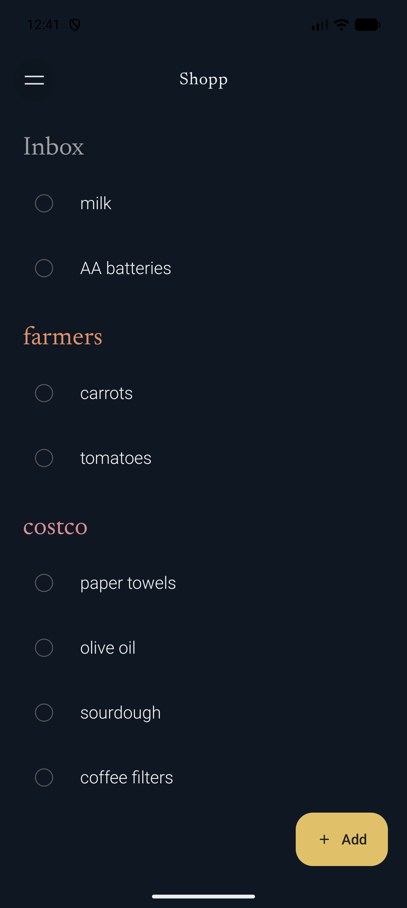
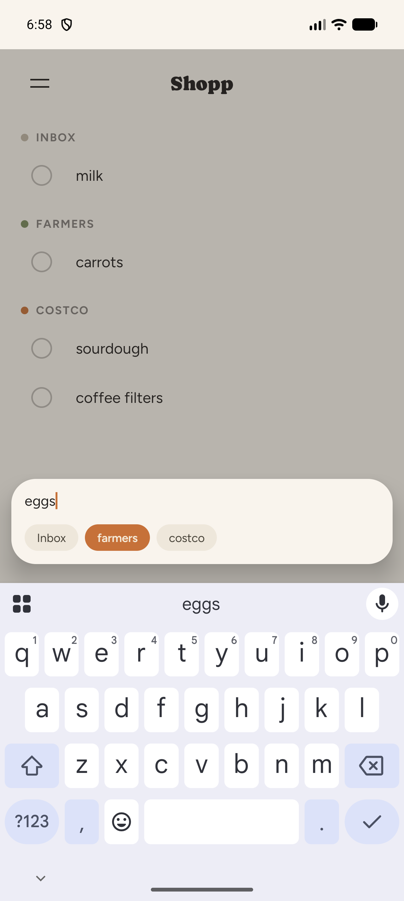
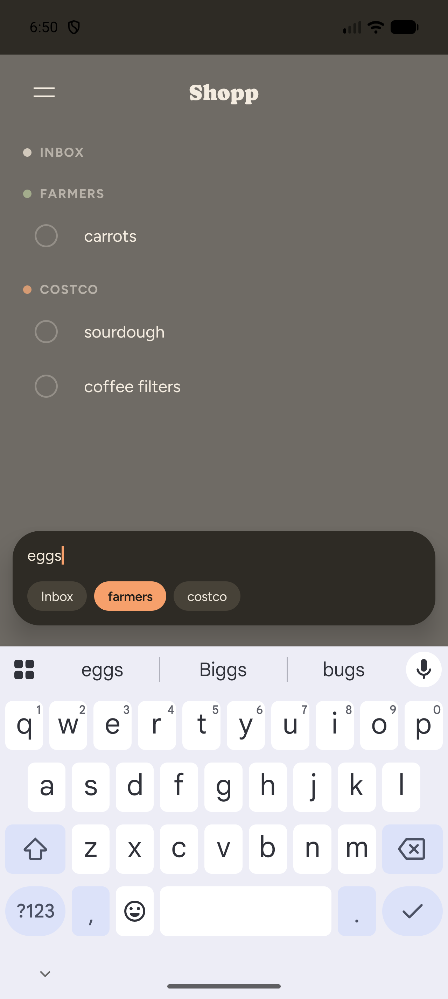
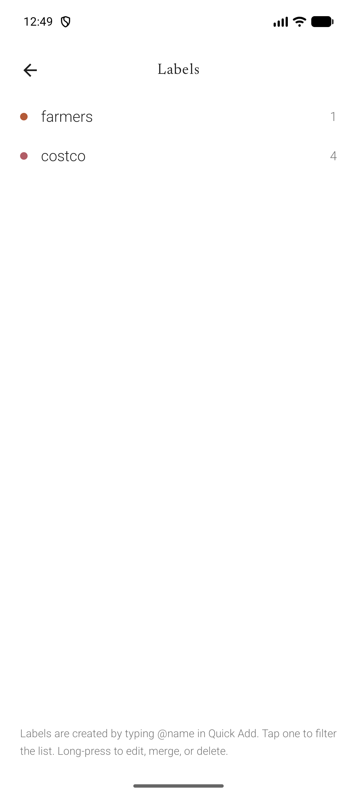
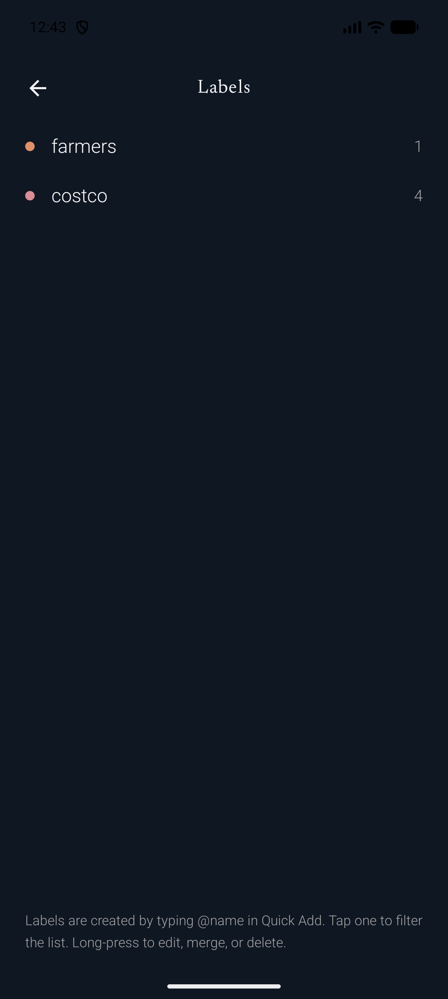
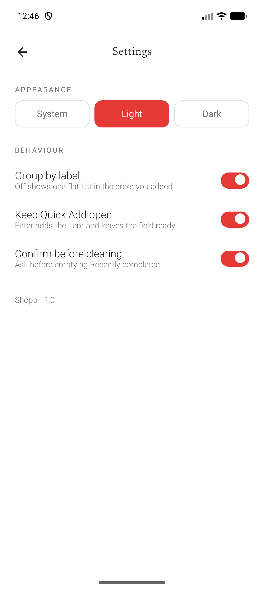
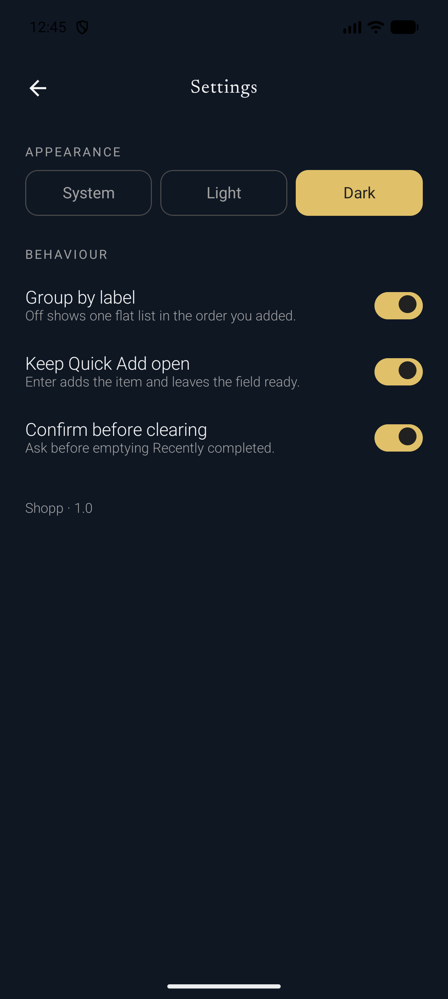

# Shopp

A fast, native Android shopping list app. Type an item, tag it with `@label` to file it into a section, tap to check it off, and add items from the lock screen with a Quick Settings tile.

**[Download the latest release](https://github.com/rrajath/shopp/releases/latest)** · [Documentation](docs-site/) · Android 8.0 (API 26)+ · MIT licensed

## Screenshots

| | Light | Dark |
|---|---|---|
| **List** |  |  |
| **Quick Add** |  |  |
| **Labels** |  |  |
| **Settings** |  |  |

More in [`screenshots/`](screenshots/).

## Features

- **Quick Add** — floating capture overlay with inline `@label` tagging and autocomplete, multi-line paste, a sticky label chip across consecutive adds, a −/+ quantity stepper, suggestions from items you've bought before (picked under the label you last bought them under), and one-tap **Frequent** / **Recent** lists of past purchases that show before you start typing. Duplicates under the same label are ignored, with a hint showing what's already on the list.
- **Quick Settings tile** — add items without unlocking the phone; opens the same capture overlay over the lock screen.
- **Home screen widget** — resizable, sectioned list with tap-to-complete, an Add button, and adjustable transparency.
- **Sectioned list** — items grouped by label (Inbox first) with sticky headers; grouping can be turned off.
- **Tap to complete, with undo** — completion is immediate, with a 4-second undo window.
- **Quantities**: items with a quantity above 1 show it in brackets, e.g. "Eggs (3)", in the list and the widget.
- **Inline edit** — tap a title to edit it and its quantity in place; URLs in titles are tappable links.
- **Recently Completed** — day-grouped history with tap-to-re-add and Clear.
- **Labels** — rename, recolor (15-color palette), merge, or delete. Deleting a label moves its items to Inbox.
- **Settings** — System/Light/Dark theme, grouping, keep Quick Add open after submit, confirm before clearing history, widget transparency.

All data stays on-device. No accounts, no network access.

### Adding the tile and widget

- **Tile:** open Quick Settings, tap the edit (pencil) icon, and drag "Add to Shopp" into your active tiles.
- **Widget:** long-press the home screen, choose Widgets, and drag "Shopp" onto it.

## Building

Requirements: Android Studio with SDK platform 36, JDK 21, and a device or emulator on API 26+.

```sh
./gradlew :app:installDebug        # build and install debug
./gradlew :app:testDebugUnitTest   # run unit tests
```

The debug build installs as "Shopp Debug" (`com.rrajath.shopp.debug`), so it can sit alongside the release build (`com.rrajath.shopp`).

### Release builds

Release builds use R8 minification and resource shrinking, and are signed with a local keystore that is never committed:

1. Generate a keystore if you don't have one:
   ```sh
   keytool -genkeypair -v -keystore app/keystore/shopp-release.jks -alias shopp -keyalg RSA -keysize 2048 -validity 10000
   ```
2. Copy `keystore.properties.example` to `keystore.properties` and fill in the values (`storeFile` is relative to the project root).
3. `./gradlew :app:assembleRelease`

Without `keystore.properties`, `assembleRelease` produces an unsigned APK.

### Publishing a release

Releases are cut locally, and CI only builds what the tag points at.

1. Record each user-facing change under `## [Unreleased]` in [`CHANGELOG.md`](CHANGELOG.md) as you go.
2. Run `scripts/release.sh X.Y.Z`. It runs the unit tests, sets `VERSION_NAME=X.Y.Z` and `VERSION_CODE` (`MAJOR*10000 + MINOR*100 + PATCH`, so `0.4.0` is `400`) in `gradle.properties`, moves the Unreleased entries under `## [X.Y.Z] - <date>`, commits `Release vX.Y.Z`, and tags it. The build fails if the two version keys disagree.
3. Push `main` and the tag with the commands the script prints.

Pushing the tag runs [`.github/workflows/release.yml`](.github/workflows/release.yml), which checks the tag matches `VERSION_NAME`, builds signed release and debug APKs, and publishes a GitHub Release using that version's CHANGELOG section as the notes. A manual run (`gh workflow run release.yml`) republishes `v<VERSION_NAME>` from `main`, for example to retry a failed build.
- The workflow needs these repository secrets:

| Secret | Value |
| --- | --- |
| `RELEASE_KEYSTORE_BASE64` | Output of `base64 -i app/keystore/shopp-release.jks` |
| `RELEASE_KEYSTORE_PASSWORD` | `storePassword` from `keystore.properties` |
| `RELEASE_KEY_PASSWORD` | `keyPassword` from `keystore.properties` |
| `RELEASE_KEY_ALIAS` | `keyAlias` from `keystore.properties` |

## Architecture

Kotlin and Jetpack Compose, with two Gradle modules: `:app` and `:designsystem` (theme tokens and shared components). One Room database backs every surface.

- **UI** — Compose screens in `ui/screens/`, driven by `ShoppViewModel`, with manual dependency injection via `AppContainer`.
- **Domain** — pure Kotlin in `domain/` and `usecases/`: the `@label` parser, label color allocation, and one use case per mutation, each run in a single Room transaction.
- **Data** — Room entities, DAOs, and repositories in `data/`. Rows use UUIDv7 keys, `updated_at` timestamps, and soft deletes.
- **Capture and widget** — the Quick Settings tile (`capture/`) and the Glance widget (`widget/`) share the in-app Quick Add UI and the same `AppContainer` and database.

See [docs/ARCHITECTURE.md](docs/ARCHITECTURE.md) and [docs/DESIGN_SYSTEM.md](docs/DESIGN_SYSTEM.md) for details.

## License

[MIT](LICENSE)
